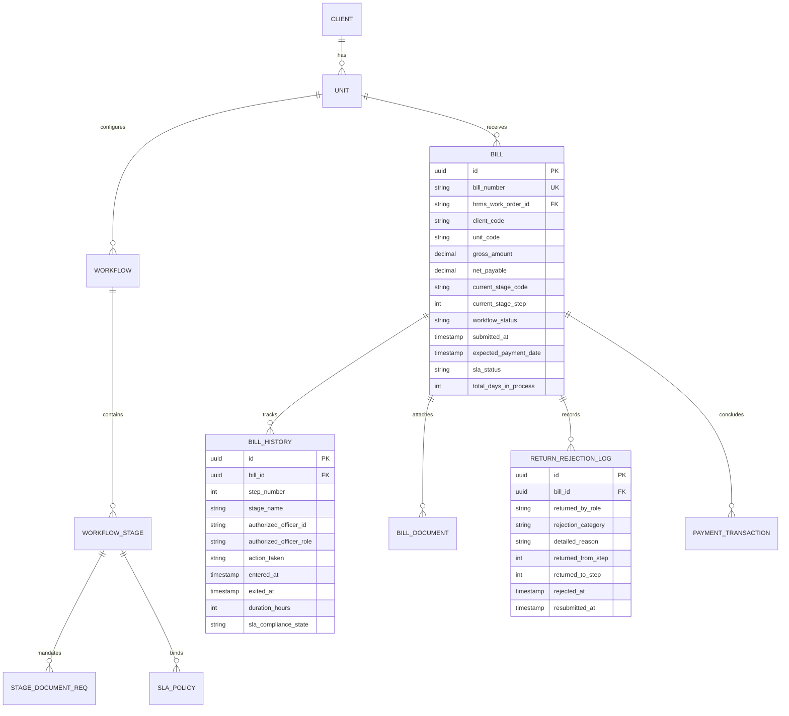
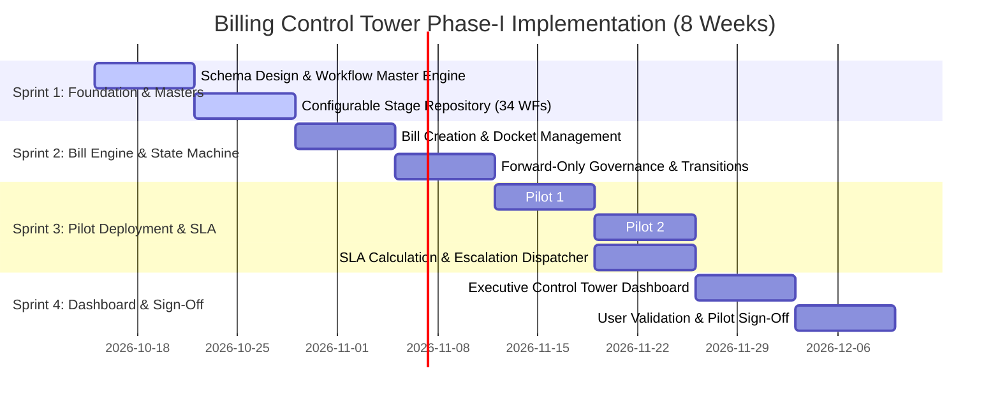

# Executive Technical Proposal: Development of the AI-Enabled Billing Control Tower
**Document Reference:** BCT-IT-PHASE1-PROPOSAL-2026-v1.0  
**Project Sponsor:** CEO  
**Business & Product Owner:** Col. Jyothi  
**Technical Lead:** Raghavendra  
**Implementation Team:** Enterprise IT Engineering & Architecture  
**Date of Submission:** October 14, 2026  
**Status:** Under Review & Approval  

---

## 1. Executive Summary & Strategic Directive

The organisation manages high-volume billing and payment cycles across diverse client sectors including Municipal Corporations (BBMP, BDA), Mass Rapid Transit (BMRCL), Healthcare Institutions (BMCRI, Bowring, Victoria, Indira Gandhi, KIMO, HIMS, YIMS), Industrial Infrastructure (KIADB Industrial Areas and Land Acquisition Offices), and State Commercial Enterprises (KPTCL, KSMCL, NCBS, GKVK).

Presently, these workflows operate without uniformity:
- Some units involve up to **16 sequential approval tiers** (e.g., Victoria, Vanivilas, and Minto Hospitals).
- Metro infrastructure projects enforce **split milestone billing** (80% operational billing via Chief Security Office & GM Operations, and 20% statutory retention via HR verification).
- Municipal works require **statutory check-measurement** and a dual-tier DC Bill / DCF Fund allocation route.
- Critical SLA bottlenecks occur without proactive alerts, resulting in delayed vendor payments and audit scrutiny.

In compliance with the executive mandate:
> **"Build independently now; integrate with HRMS later."**

This document delivers the **Phase-I Technical Proposal and Workflow Master** for review and approval prior to full-scale development, fulfilling all 11 deliverables stipulated in Section 12 of the directive.

---

## 2. Deliverable 1: Workflow Master (Derived from Official Billing Process Document)

All **34 organizational billing workflows** captured in the official *Billing Process Updations* matrix have been cataloged into a digital workflow repository.

### Summary Classification Table

| # | Client / Organization | Unit / Division | Sector | Total Stages | Approval Route Overview | Pilot Designation |
| :--- | :--- | :--- | :--- | :---: | :--- | :---: |
| **01** | **BBMP** | BBMP Lakes (North, Central, West, East, South) | Civic & Municipal | 15 | Tapal → AE → AEE → EE → Attendance Cert → EE → JC → Addl. Rev. Commr → Commr → DCF → Fund → EE → DC Bill → DCF → Payments | **PILOT 1 (North)** |
| **02** | **BBMP** | BBMP Yelahanka Zone | Civic & Municipal | 15 | Tapal → AE → AEE → EE → Attendance Cert → EE → JC → Addl. Rev → Commr → DCF → Fund → EE → DC Bill → DCF → Payments | Standard |
| **03** | **BDA** | BDA Man Power Wing | Civic & Municipal | 13 | Tapal → Case Worker → DS-1 → FM → Case Worker → Accts Supt → CAO → FM → DS-1 → Secretary → DS-1 → FM → Payments | Standard |
| **04** | **BDA** | BDA Security Wing | Civic & Municipal | 13 | Tapal → Case Worker → DS-1 → SP Section → Inspector → DS-1 → FM → Accounts/CAO → FM → DS-1 → Secy/Commr → FM → Payments | Standard |
| **05** | **BMCRI** | BMCRI College Security & Housekeeping | Healthcare | 12 | Tapal/Dean → AO → Case Worker → Warden Cert → Supt → AO → CAO → FA → Dean → Cash Section/FA → Dean → Treasury Payment | Standard |
| **06** | **BMCRI** | Victoria Hospital Housekeeping & Security | Healthcare | 16 | Tapal → MS → Case Worker → Matron Cert → Office Supt → AO → RMO → MS → Case Worker → Supt → AO → CAO → FA → Dean → Cash Section → Dean Treasury | Standard |
| **07** | **BMCRI** | Vanivilas Hospital Housekeeping & Security | Healthcare | 16 | Tapal → MS → Case Worker → Matron Cert → Office Supt → AO → RMO → MS → Case Worker → Supt → AO → CAO → FA → Dean → Cash Section → Dean Treasury | Standard |
| **08** | **BMCRI** | Minto Hospital Housekeeping & Security | Healthcare | 16 | Tapal → MS → Case Worker → Matron Cert → Office Supt → AO → RMO → MS → Case Worker → Supt → AO → CAO → FA → Dean → Cash Section → Dean Treasury | Standard |
| **09** | **BMRCL** | BMRCL Project Wing (80% Operational) | Transit & Metro | 7 | Bill to CSO Office → Attendance & ASCO Approval → CSO Approval → Case Worker E-Office / GM Ops → AGM Finance → Finance Approval → Audit & Payment | **PILOT 2 (80%)** |
| **09** | **BMRCL** | BMRCL Project Wing (20% Statutory HR) | Transit & Metro | 8 | 20% Bill to CSO / HR Verification → HR Manager Approval → Accounts Verification → AGM Finance → Finance Approval → Audit Cert → Audit Approval → Payments | **PILOT 2 (20%)** |
| **10** | **BMRCL** | Metro Security Reach 2E & 3C (80%) | Transit & Metro | 6 | Attendance / ASCO → CSO Approval → Case Worker E-Office / GM Ops → AGM Finance → Finance Approval → Audit & Payments | Standard |
| **10** | **BMRCL** | Metro Security Reach 2E & 3C (20%) | Transit & Metro | 7 | 20% Bill HR Verification → HR Manager → Accounts Verification → AGM Finance → Finance Approval → Audit Cert → Audit Approval → Payments | Standard |
| **11** | **BMRCL** | Metro Security Reach 1 (80% & 20%) | Transit & Metro | 7 / 8 | CSO Stream (80%) and HR Compliance Stream (20%) | Standard |
| **12** | **BMRCL** | Metro Tom (80% & 20%) | Transit & Metro | 6 / 8 | Operational Certification (80%) and HR Verification (20%) | Standard |
| **13** | **Bowring Hospital** | Bowring & Lady Curzon and Gosha Hospital | Healthcare | 12 | Certifications → Matron → RMO → Nodal Officer → MS → TAPAL → Case Worker → Cash Section Case Worker → MS → FA → Dean → Cash Section Payments | Standard |
| **14** | **SABVMC** | Atal Bihari Vajpayee Medical College | Healthcare | 7 | Nodal Officer → Wardens/Special Officer → TAPAL → Case Worker → Dean → Case Worker → Accounts Section Payments | Standard |
| **15** | **Charaka** | Charaka Hospital | Healthcare | 8 | Certifications → Matron → Nodal Officer → Special Officer → TAPAL → Case Worker → Dean → Case Worker / Accounts Payments | Standard |
| **16** | **Indira Gandhi** | Indira Gandhi Institute of Child Health | Healthcare | 11 | Tapal → Director Sign → Case Worker → Matron → MS → Case Worker → Accountant → Supt/AO → Director → AO → Supt/Cashier Payment | Standard |
| **17** | **KIADB** | DO EE1 Office & Harohalli Industrial | Industrial | 10 | Tapal → Case Worker → Engineers Cert → Case Worker → Head Office Approval → DC Approval → Finance Approval → EM Approval → EE → Payments | Standard |
| **18** | **KIADB** | Peenya, Awerahalli, Sompura, Dabaspete | Industrial | 10 | Tapal → Case Worker → Engineers Cert → Case Worker → Head Office Approval → DC Approval → Finance Approval → EM Approval → EE → Payments | Standard |
| **19** | **KIADB** | SEZ Devanahalli, Aerospace, IT Park, Hardware | Industrial | 10 | Tapal → Case Worker → Engineers Cert → Case Worker → Head Office Approval → DC Approval → Finance Approval → EM Approval → EE → Payments | Standard |
| **20** | **KIMO** | KIMO DEO Technicians & Group D | Healthcare | 12 | Tapal → AO → Director → CAO → FA → Case Worker → RMO/MS Cert → FA → Joint MS/FA → Director/FA → Case Worker/FA → Tally Cheque Payments | Standard |
| **21** | **KIMO** | KIMO Unit 1, 2, 3 HK & SG | Healthcare | 11 | AO → Director → CAO → FA → Case Worker → RMO/MS Cert → FA → Joint MS/FA → Director/FA → Case Worker/FA → Tally Cheque Payments | Standard |
| **22** | **KPTCL** | KPTCL Transmission Lines & Substations | State Enterprise | 8 | Tapal → Case Worker → Admin → Head Office → Finance Approval → Admin → Case Worker → Payments | Standard |
| **23** | **KSMCL** | Mining Exploration & Processing Areas | State Enterprise | 9 | Tapal → Case Worker → Mines Cert → Audit → Finance Approval → MD Approval → Case Worker → Accounts → Finance Approval Payments | Standard |
| **24** | **Kumara Krupa** | State Guest House Bangalore | State Enterprise | 10 | Tapal → Case Worker → Manager → Accounts Supt → Special Officer → Director → Special Officer → Accounts Supt/Manager → Case Worker → Payments | Standard |
| **25** | **Kumara Krupa** | State Guest House Mysore | State Enterprise | 10 | Tapal → Case Worker → Manager → Accounts Supt → Special Officer → Director → Special Officer → Accounts Supt/Manager → Case Worker → Payments | Standard |
| **26** | **PMSSY** | PMSSY Super Speciality Hospital | Healthcare | 9 | Tapal → Case Worker → Certification → AO → FA → Special Officer → FA → Case Worker Accounts → Payments | Standard |
| **27-29**| **Sanjay Gandhi** | SG Hospital (HK, Security, Staff) | Healthcare | 11 | Tapal → Director Sign → Case Worker → Matron → MS → Case Worker → Accountant → Supt/FO → Director → FO → Supt/Cashier Payment | Standard |
| **30** | **TECC** | Trauma Care Centre / BMCRI | Healthcare | 12 | Tapal → Case Worker → AO → Special Officer → BMCRI Case Worker → Supt → AO → CAO → FA → Dean → TECC Case Worker/FA → Payments | Standard |
| **31** | **GKVK** | University of Agricultural Sciences | Education/Govt | 10 | Tapal → Estate Officer → Case Worker → Bill Cert → Case Worker → Engineer → Accountant → BR → Comptroller Supt → Comptroller Payments | Standard |
| **32** | **NCBS** | National Centre for Biological Sciences | Research Institute | 7 | Tapal → Case Worker → Bill Cert → Security Incharge/Accounts → Supt → Cheque Section → Payments | Standard |
| **33** | **HIMS** | Hassan Institute of Medical Sciences | Healthcare | 12 | Tapal → Case Worker → Bill Cert → Case Worker → RMO → MS → CAO → FA → Director → DC Bill → Accounts → Payments | Standard |
| **34** | **YIMS** | Yadgiri Institute of Medical Sciences | Healthcare | 10 | Tapal → Case Worker → Bill Cert → Case Worker → FA → Dean → FA → Case Worker Cheque Section/FA → Dean → Payments | Standard |

---

## 3. Deliverable 2: Identification of Common vs. Client-Specific Stages

### 2.1 The 7 Standard Canonical Stages (Universal Foundation)
Across all 34 workflows, every process maps cleanly into 7 canonical operational stages:

1. **Docketing & Registry (Inward / Tapal):** Initial receipt, timestamping, barcode docket issuance, and basic completeness verification.
2. **First-Line Administrative Scrutiny (Case Worker / Inward Section):** Verification of attendance registers, work order citation, EPF/ESI challans, and contractor credentials.
3. **Field / Operational Certification:**
   - *Engineering/Municipal:* AE / Site Engineer inspection and Measurement Book (MB) entry.
   - *Hospitals:* Matron / Nursing Superintendent ward hygiene certification or Warden verification.
   - *Transit:* ASCO / Station Safety verification.
   - *Mines:* Mine Manager weighbridge and pit certification.
4. **Middle-Tier Administrative / Technical Sanction:**
   - *Engineering:* AEE check-measurement (mandatory 25% under KPWD code) and EE divisional scrutiny.
   - *Hospitals:* Resident Medical Officer (RMO) and Medical Superintendent (MS) operational review.
   - *Industrial:* KIADB Head Office / Development Commissioner clearance.
5. **Financial & Accounts Scrutiny:** Scrutiny of rates against Schedule of Rates (SR), statutory deductions (TDS, GST-TDS, Labour Cess, Retention), performed by Accounts Superintendent, CAO, FA, or AGM Finance.
6. **Statutory Pre-Audit & Executive Concurrence:** Pre-audit clearance by Internal Audit or Chief Accounts Officer, followed by executive sign-off from Commissioner, Dean, Managing Director, or Board Executive Member.
7. **Disbursement & Payment Closure:** DC Bill / Treasury scroll generation, Cheque writing, or bank NEFT/RTGS release by Cash Section.

### 2.2 Client-Specific Nuances (Requiring Configurable Rules)

```
[BMRCL Transport Pattern]                 [BBMP Municipal Pattern]                 [Autonomous Hospital Pattern]
       CSO Office                                  AE / AEE                               Matron / Warden
           │                                          │                                          │
    80% Operational Milestone                Measurement Book (MB) Check              Ward Cleanliness Certification
           │                                          │                                          │
    GM Operations Approval                 25% KPWD Check Measurement                  Medical Superintendent (MS)
           │                                          │                                          │
     Corporate Finance                     Double Bill: DC Bill + DCF                   Financial Advisor (FA)
           │                                          │                                          │
20% Statutory HR Clearance                  Zonal Joint Commissioner                      Dean / Director
           │                                          │                                          │
       Disbursement                           Treasury Disbursement                     Govt Treasury Scroll
```

---

## 4. Deliverable 3: Proposed Database Architecture

A relational architecture (PostgreSQL 16) is proposed with strict non-repudiation and forward-only state machine integrity.



### Key DDL Specifications
- **`bills`**: Immutable bill registry storing the client code, unit ID, gross amount, current step, SLA flag (`WITHIN_SLA`, `APPROACHING_SLA`, `BREACHED_SLA`), and payment status.
- **`bill_histories`**: Append-only log of every transition recording officer ID, IP address, timestamp, previous step, and next step.
- **`workflow_stages`**: Configurable stages with step order, role bindings, SLA hours, and escalation rules.
- **`sla_policies`**: Warning threshold (e.g., 75% SLA consumed) and breach threshold (100% SLA consumed).
- **`return_rejection_logs`**: Capture categorized defects (e.g., Measurement mismatch, Missing Form V muster roll, Inconsistent tax invoice).

---

## 5. Deliverable 4: Proposed Application Architecture

The system follows an independent, cloud-ready, event-driven modular architecture:

```
┌────────────────────────────────────────────────────────────────────────┐
│                   PRESENTATION LAYER (React 19 SPA)                    │
│ ┌──────────────────────┐ ┌────────────────────┐ ┌────────────────────┐ │
│ │ Control Tower Dash   │ │ Bill Master Tracker│ │ 34-Workflow Engine │ │
│ └──────────────────────┘ └────────────────────┘ └────────────────────┘ │
│ ┌──────────────────────┐ ┌────────────────────┐ ┌────────────────────┐ │
│ │ SLA Escalation Radar │ │ HRMS Sync Console  │ │ AI Document Review │ │
│ └──────────────────────┘ └────────────────────┘ └────────────────────┘ │
└───────────────────────────────────┬────────────────────────────────────┘
                                    │ HTTPS / REST / WebSockets
┌───────────────────────────────────▼────────────────────────────────────┐
│                    API & BUSINESS LOGIC LAYER                          │
│ ┌──────────────────────┐ ┌────────────────────┐ ┌────────────────────┐ │
│ │ Auth & RBAC Guard    │ │ State Machine Engine│ │ SLA Monitor Service│ │
│ └──────────────────────┘ └────────────────────┘ └────────────────────┘ │
│ ┌──────────────────────┐ ┌────────────────────┐ ┌────────────────────┐ │
│ │ Audit & Non-Repud.   │ │ Notification Broker│ │ HRMS API Adaptor   │ │
│ └──────────────────────┘ └────────────────────┘ └────────────────────┘ │
└───────────────────────────────────┬────────────────────────────────────┘
                                    │
┌───────────────────────────────────▼────────────────────────────────────┐
│                       PERSISTENCE & AI SERVICES                        │
│ ┌──────────────────────┐ ┌────────────────────┐ ┌────────────────────┐ │
│ │ PostgreSQL 16 DB     │ │ Redis SLA Cache    │ │ PDF/OCR Analyzer   │ │
│ └──────────────────────┘ └────────────────────┘ └────────────────────┘ │
└────────────────────────────────────────────────────────────────────────┘
```

1. **Independent Core:** Zero runtime dependency on the ongoing HRMS rollout.
2. **Forward-Only State Machine:** Enforces governance rules preventing arbitrary skip-stepping or untracked rollbacks.
3. **Reactive SLA Heartbeat:** Asynchronous cron monitoring bill age against configured stage SLAs and emitting high-priority escalation notifications.
4. **Phase II AI Readiness:** Built-in PDF Parsing and Table Extraction pipeline capable of automated document metadata validation.
5. **Phase III HRMS Abstraction Layer:** Pre-built outbound webhooks and inbound ingestion REST endpoints.

---

## 6. Deliverable 5: Screen and Module Inventory

| Module Code | Module Name | Primary User Persona | Core Functionality |
| :--- | :--- | :--- | :--- |
| **MOD-01** | **Executive Control Tower Dashboard** | CEO, Col. Jyothi, Raghavendra | Executive cockpit displaying Total Bills, Value in Process, SLA distribution, Client performance, and the **"Intervention Required Today"** action queue. |
| **MOD-02** | **Bill Master & Journey Tracker** | Field Officers, Finance, Audit | Comprehensive bill registry, step-by-step visual progress bar, days pending in stage, responsible officer, and payment voucher generation. |
| **MOD-03** | **Configurable 34-Workflow Engine** | System Administrator | Interactive visual flowchart of all 34 workflows with live step editing, SLA configuration, and document rule assignment. |
| **MOD-04** | **SLA & Escalation Command Center** | Department Heads, Operations Lead | Active SLA countdown timers, bottleneck heatmaps, overdue aging brackets (0-7d, 8-15d, 16-30d, 30d+), and automated escalation dispatches. |
| **MOD-05** | **Stage Approval & Scrutiny Inbox** | Section Officers (AE, EE, Matron, CAO) | Role-filtered action queue to inspect supporting files, approve to next step, or return with structured rejection codes. |
| **MOD-06** | **Return & Rejection Resolution Hub** | Field Staff, Contractors | Tracks returned bills, display exact reason codes, and manages resubmission cycles. |
| **MOD-07** | **Immutable Audit & Compliance Log** | Internal & Statutory Auditors | Cryptographically verifiable activity timeline capturing user identity, IP address, timestamp, and field-level diffs. |
| **MOD-08** | **HRMS Integration Sandbox** | IT Developers, Integrators | Live simulator testing contract ingestion, employee verification, and bill status webhook dispatches. |
| **MOD-09** | **AI Document Assistant (Phase II Ready)** | Verification Officers | Deep PDF analysis, OCR table extraction, and discrepancy detection for invoices and measurement books. |

---

## 7. Deliverable 6: User-Role Matrix (RACI Governance)

| Role Code | Role Title | Typical Designations | View Dashboard | Create Bill | Approve Stage | Return Bill | Config Workflow | Override SLA |
| :--- | :--- | :--- | :---: | :---: | :---: | :---: | :---: | :---: |
| **ROLE-EXEC** | **Executive Leadership** | CEO, Col. Jyothi | Full | No | View Only | View Only | No | Yes |
| **ROLE-TECH** | **Technical Lead** | Raghavendra | Full | Yes | Full (Dev) | Full (Dev) | Yes | Yes |
| **ROLE-ADMIN**| **System Administrator**| Enterprise IT Admin | Full | Yes | Yes | Yes | Yes | Yes |
| **ROLE-FIELD**| **Field Officer** | AE, Matron, ASCO, Warden | Assigned Unit | Yes | Step 1-3 | No | No | No |
| **ROLE-DIV**  | **Divisional Authority**| EE, MS, CSO, DS-1, GM Ops | Division | No | Step 4-8 | Yes | No | No |
| **ROLE-FIN**  | **Finance & Accounts** | CAO, FA, AGM Finance, DCF | All Bills | No | Finance Steps | Yes | No | No |
| **ROLE-AUDIT**| **Statutory Auditor**  | Pre-Audit Officer, Auditor | Read All | No | Audit Steps | Yes | No | No |
| **ROLE-CASH** | **Disbursement Officer**| Cash Section, Treasury | Payment Queue | No | Disburse | No | No | No |

---

## 8. Deliverable 7: API Architecture for Future HRMS Integration

To ensure seamless future integration without rework, the Billing Control Tower exposes standardized RESTful endpoints with HMAC-SHA256 signatures and idempotency headers:

### Inbound Endpoints (HRMS → Billing Control Tower)
- `POST /api/v1/integration/hrms/work-orders`  
  *Payload:* `{ workOrderId, contractCode, clientCode, unitCode, sanctionedAmount, validFrom, validTo, billingTerms }`
- `POST /api/v1/integration/hrms/personnel-sync`  
  *Payload:* `{ employeeId, officialName, designatedRole, department, email, authorityLimit }`
- `GET /api/v1/integration/hrms/active-contracts/:unitCode`  
  *Response:* Active work orders available for billing docket creation.

### Outbound Endpoints (Billing Control Tower → HRMS Webhook)
- `POST https://hrms.org/api/v1/billing-events/stage-transition`  
  *Dispatched when a bill advances a stage.*  
  *Payload:* `{ billId, billNumber, client, unit, previousStage, newStage, pendingWithRole, slaStatus, timestamp }`
- `POST https://hrms.org/api/v1/billing-events/payment-completed`  
  *Dispatched upon final payment disbursement.*  
  *Payload:* `{ billId, billNumber, grossAmount, deductions, netPaidAmount, paymentReference, disbursementDate }`

---

## 9. Deliverable 8: Proposed Phase-I Development Timeline

The Phase-I development will execute across **four 2-week sprints (8 weeks total)**:



---

## 10. Deliverable 9: Resource Requirement

To execute Phase-I within the 8-week timeline, the following dedicated squad is requested:

1. **Technical Lead & Solution Architect (1 FTE — Raghavendra):** Overall technical stewardship, architecture compliance, security review, and HRMS API alignment.
2. **Senior Full-Stack Engineer (1 FTE):** Node.js / PostgreSQL workflow engine, state transition enforcement, SLA heartbeat cron, and webhook dispatchers.
3. **Frontend UI/UX Engineer (1 FTE):** React 19 SPA, Control Tower dashboard widgets, visual workflow graph builder, and mobile-responsive action inbox.
4. **Domain Business Analyst / Functional QA (1 FTE):** Finance and engineering workflow validation, user acceptance testing, and coordination with Col. Jyothi.
5. **Business / Product Owner (Col. Jyothi):** Milestone reviews, cross-departmental coordination with Finance and Operations.

---

## 11. Deliverable 10: Two Proposed Pilot Units & Justification

Rather than attempting all 34 workflows simultaneously, the following two pilot units are recommended for initial operational rollout:

### Pilot 1: BBMP Lakes Division (North Zone)
- **Sector:** Civic & Municipal Infrastructure (Public Works)
- **Workflow Length:** 15 Sequential Approval Stages
- **Key Justification:**
  - Exhibits the most rigorous civil engineering verification path (AE Measurement Book entries, mandatory 25% KPWD check-measurements by AEE, and divisional review by EE).
  - Tests the complex **Double Bill Route**: generating the preliminary DC Bill and securing the final DCF Fund allocation.
  - Success here proves that the platform can handle any government municipal workflow (Yelahanka, BDA, etc.).

### Pilot 2: BMRCL Project Wing (80% / 20% Split Milestone)
- **Sector:** Mass Rapid Transit Infrastructure (Corporate PSU)
- **Workflow Length:** Dual Parallel / Sequential Streams (7 stages for 80% and 8 stages for 20%)
- **Key Justification:**
  - Tests corporate infrastructure split-stream billing where payment release is decoupled into operational delivery (80% via CSO & GM Operations) and statutory HR/labour compliance (20% via HR Manager & EPF/ESI verification).
  - Validates e-office routing and corporate audit approvals.
  - Success here establishes the blueprint for all BMRCL metro reaches and industrial units.

---

## 12. Deliverable 11: Information Required from Finance/Accounts to Finalize

The IT team requires formal validation on the following four key parameter categories prior to Sprint 3 configuration:

1. **Service Level Agreement (SLA) Matrix:**
   - Specific working days allowed for each stage (e.g., Tapal: 1 day; AE Site Check: 3 days; Accounts Scrutiny: 2 days).
   - Rules regarding public holidays, court holidays, and second Saturdays.
2. **Mandatory Document Checklists by Billing Category:**
   - Required attachments for Civil works (MB extract, Geo-tagged photos, Quality test certificates).
   - Required attachments for Manpower/Security (Form V muster roll, ESI challan, EPF ECR scroll, Bank wage disbursement summary).
3. **Escalation Rules & Notification Triggers:**
   - Threshold for warning alerts (e.g., when 75% of stage SLA has lapsed).
   - Hierarchy of escalation (e.g., if AE exceeds 3 days, notify AEE immediately; if EE exceeds 4 days, alert Joint Commissioner).
4. **Standardized Return & Rejection Taxonomy:**
   - Formal classification of defect codes (e.g., `DEF_01: Quantity exceeds work order`, `DEF_02: Statutory PF/ESI under-deposit`, `DEF_03: Defective photographic evidence`, `DEF_04: Schedule of Rates discrepancy`).

---

## 13. Governance & Next Steps

This proposal is hereby submitted to:
- **Project Sponsor:** CEO
- **Business/Product Owner:** Col. Jyothi

Upon review and written approval:
1. IT Team will lock Sprint 1 backlog and initialize database migrations.
2. Finance validation workshop will be scheduled for SLA and Document checklists.
3. Pilot 1 (BBMP Lakes North Zone) and Pilot 2 (BMRCL Project Wing) sandbox will be opened for initial field testing.

**Submitted By:**  
*Raghavendra & Enterprise IT Implementation Squad*  
October 14, 2026
